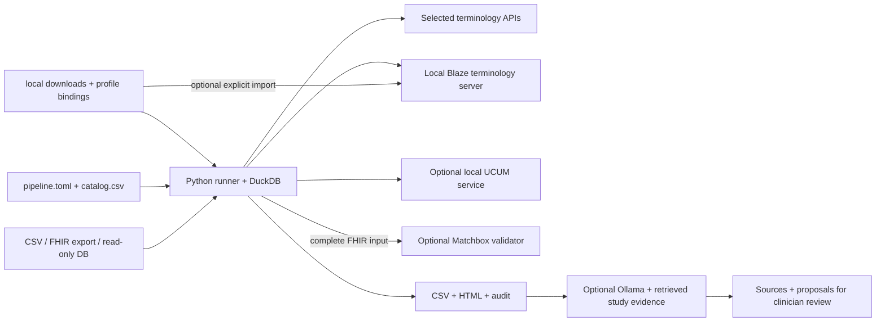
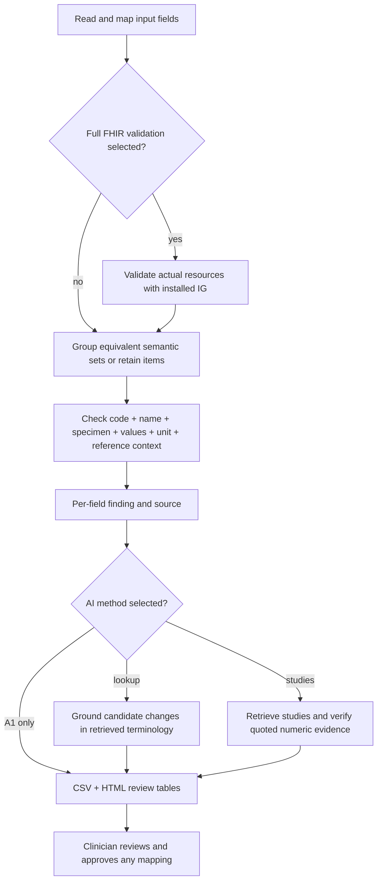

# Semantic Plausibility

**Review laboratory exports as complete code–name–specimen–value–unit–reference sets.** Python reads CSV, FHIR or a database, groups equivalent measurements, checks real terminology, and writes CSV + an HTML review table. Optional local AI adds sourced proposals and study evidence. Clinicians approve mappings.

## What you configure

| File / folder | Purpose |
| --- | --- |
| **`pipeline.toml`** | Your input columns, aggregation, target profile, selected sources, model and output |
| **`catalog.csv`** | Editable directory of services and download locations; selected by `source="ID"` in TOML |
| **`.env`** | Credentials and optional host mount/port settings |
| **`local/`** | Your downloaded terminology, profiles and secret files; ignored by Git |
| **`output/`** | Your reports and audit files; ignored by Git |
| **`compose.yaml`** | The single Docker/Podman stack; start only the services needed |

Terminology concepts, downloaded FHIR definitions and model weights are acquired during setup and kept in runtime storage. The repository contains code, the source directory and illustrative input examples.

## 1. First setup

Run these commands in the repository directory. Existing private files are preserved.

```sh
cp -n pipeline.example.toml pipeline.toml
cp -n .env.example .env
mkdir -p local/profiles local/terminologies/loinc local/terminologies/bfarm-lab local/secrets output ../input
```

Open **`pipeline.toml`**. The supplied input is `examples/laboratory.csv`. Choose your LOINC route:

| Route | What to do |
| --- | --- |
| **Official API** — default | Keep `lookups.loinc.source="loinc-api"`. Enter your LOINC account in `.env`: `LOINC_FHIR_USERNAME` and `LOINC_FHIR_PASSWORD`. [Register/access](https://loinc.org/kb/api/auth) |
| **Local release** | Download the full [LOINC CSV](https://loinc.org/downloads/), place `Loinc.csv` in `local/terminologies/loinc/`. Set `source="loinc-file"`, `version="YOUR_RELEASE"`, `complete=true` in the existing LOINC block. |

Keep `lookups.ucum.source="ucum-api"` for the public NLM service. To add your BfArM translations, extract them under `local/terminologies/bfarm-lab/` and enable `lookups.bfarm_lab`. The full base LOINC edition supplies membership and axes; the matching translation supplies German names. [All downloads, local servers and credentials](docs/lookups.md).

### Choose one runtime

**Podman** — on macOS/Windows, start your Podman machine first:

```sh
podman machine start
podman-compose build run-plausibility-check
podman-compose --profile setup run --rm profile-init
podman-compose run --rm run-plausibility-check config-check --connections
podman-compose run --rm run-plausibility-check check --out output/01-lookup.csv
```

**Docker** — with Docker running:

```sh
docker compose build run-plausibility-check
docker compose --profile setup run --rm profile-init
docker compose run --rm run-plausibility-check config-check --connections
docker compose run --rm run-plausibility-check check --out output/01-lookup.csv
```

**Python / uv** — Python and dependencies are selected by `uv.lock`:

```sh
uv sync --locked --extra postgres
uv run --no-sync --env-file .env run-plausibility-check profile-init
uv run --no-sync --env-file .env run-plausibility-check config-check --connections
uv run --no-sync --env-file .env run-plausibility-check check --out output/01-lookup.csv
```

`profile-init` retrieves the pinned MII Laboratory snapshot and selected HL7 binding into `local/profiles/`; repeat calls verify and reuse them. `config-check --connections` tests the selected sources. Open **`output/01-lookup.html`** and inspect each field's finding, proposal and source. Use a fresh `--out` name for the next run.

## 2. Choose the input and method

| Input | Set in the same TOML | Example and mapping |
| --- | --- | --- |
| Individual CSV | `type="csv"`, `granularity="individual"`, `output.mode="distinct"` | [Individual values](examples/lab/README.md#individual-csv): three measurements → one set |
| Aggregate CSV | `type="csv"`, `granularity="distinct"` | [Aggregate values](examples/lab/README.md#aggregated-csv): numeric count/mean/SD/min/max and one common unit |
| FHIR files or server export | `type="fhir_file"`, `granularity="individual"` | [FHIR](examples/lab/README.md#fhir): JSON, Bundle, NDJSON; select server data upstream with TORCH/CQL |
| Database | `type="sqlite"` or `"postgres"`, table + column map | [SQLite / PostgreSQL](examples/lab/README.md#sqlite): read-only source access |

`output.mode="distinct"` groups complete equivalent contexts for evidence research. `mode="items"` retains source IDs for individual review. Units and reference contexts remain part of the group key. Mean, SD, min and max contain **numbers**, with their unit in the row's `unit_code`.

| Method | Command after setup | Result |
| --- | --- | --- |
| A1: lookup + consistency | `check` | Code/name, UCUM, code–unit fit, numeric/reference consistency |
| A2: AI-supported lookup | `research-evidence --scope lookup --report output/01-lookup.csv --out output/03-ai.csv` | Candidate corrections, sourced and awaiting review |
| A3: study evidence | `research-evidence --scope studies --report output/01-lookup.csv --out output/04-evidence.csv` | Relevant study quotations, measured values/intervals and applicability context |
| Full FHIR validation | `validation.enabled=true` for complete FHIR input | Separate Matchbox/HL7 conformance results before aggregation; [setup](docs/validation.md) |

### Local AI: select, download, run

Set **`models.local.model`** in TOML. The template selects `ministral-3:3b`. `base_url` is the native Python endpoint; `container_base_url` is the Compose endpoint.

```sh
podman-compose --profile research up -d ollama
podman-compose --profile research run --rm model-init
podman-compose --profile research run --rm catalog-init
podman-compose --profile research run --rm research-evidence research-evidence --scope lookup --report output/01-lookup.csv --out output/03-ai.csv
podman-compose --profile research run --rm research-evidence research-evidence --scope studies --report output/01-lookup.csv --out output/04-evidence.csv
```

Docker uses the same commands with `docker compose` in place of `podman-compose`. Python uses `uv run --no-sync --env-file .env run-plausibility-check` followed by the same subcommands, with your local Ollama running. `model-init` downloads the selected model only if missing; weights persist in `semantic-plausibility-ollama`. `catalog-init` explicitly acquires the official UCUM definition/candidate files for AI spelling suggestions, stored in `local/`. [Own model / LM Studio](docs/shipped-stack.md#models).

## 3. Understand the stack and decisions





The runner is a one-shot batch command. Ollama, Blaze, UCUM and Matchbox are optional persistent services. Start Blaze only to serve your imported terminology or support FHIR validation. Direct file lookup reads local files without a server. [Containers and persistent storage](docs/shipped-stack.md).

## 4. Working examples and tests

```sh
bash tools/run-podman-examples.sh
```

This separate example suite uses `examples/lab/aggregated.csv`, explicitly selected **public test LOINC + NLM APIs**, real profile downloads, Matchbox with Blaze’s explicitly enabled built-in LOINC, and Ollama. It creates four separate report folders and prints the index path. Your private input/configuration stays selected only for your own runner commands. Preview with `--dry-run`; run A1 alone with `--lookup-only`. Cached images and volumes are reused.

For library tests, install the actual profile once, then:

```sh
uv run --no-sync run-plausibility-check profile-init --config pipeline.example.toml
uv run --no-sync python -m unittest discover -s tests -v
```

Tests cover grouping, numeric statistics, input validation, configuration, report/audit integrity and source routing. Live API/model/validator tests are explicit opt-ins; they use real services. [Test details and code responsibilities](docs/implementation.md).

**Manual:** [sources/downloads](docs/lookups.md) · [input recipes](examples/lab/README.md) · [TOML reference](docs/configuration.md) · [FHIR validation](docs/validation.md) · [research and quotations](docs/research.md) · [HTML manual](docs/index.html).
