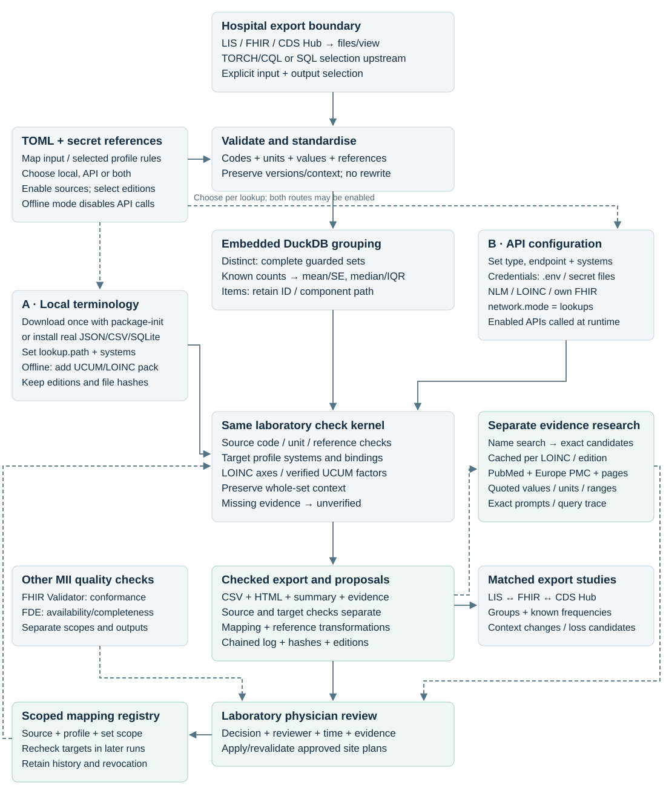
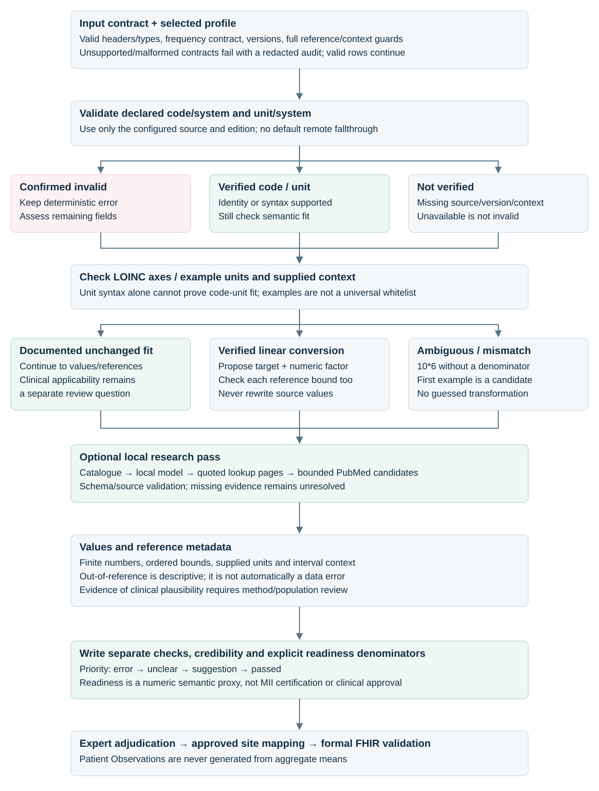

# Semantic plausibility for laboratory and medication exports

A local Python library and batch runner for reviewing **code + code system + analyte/name + value + unit + unit system + reference ranges**. Start with a distinct LIS/database export or complete FHIR Observations. Receive a CSV and HTML report with separate checks, mapping proposals, transformations and their sources. Clinicians decide whether a proposed mapping is correct; input data remains unchanged.

**Implemented:** laboratory Observation, FHIR R4 / MII Laboratory 2026.0.3, real terminology lookups, optional local FHIR validation, local AI recommendations, bounded literature retrieval and clinician feedback. **MedicationRequest and MedicationAdministration** now have executable [terminology and dose checks](examples/medication/README.md), with MII Medication 2026.0.1 validation recipes. Medication AI/evidence research and clinical dose appropriateness remain unimplemented.

## Start here

Run from the repository directory. These commands preserve existing configuration:

```sh
cp -n pipeline.example.toml pipeline.toml
cp -n .env.example .env
mkdir -p ../input local output
```

For the supplied test, `[input].path` in `pipeline.toml` must be `examples/laboratory.csv`. An existing configuration is not reset by the copy command. Input, profile, endpoints and model belong in TOML; credentials belong in `.env` or secret files. No shell exports are required.

Choose a runtime:

| Runtime | Prepare once | Run the first check |
| --- | --- | --- |
| Python / uv | `uv sync --locked --no-editable` | `uv run --no-sync --env-file .env run-plausibility-check --out output/01-lookup.csv` |
| Docker Compose | `docker compose build run-plausibility-check` | `docker compose run --rm run-plausibility-check check --out output/01-lookup.csv` |
| Podman Compose | Podman running; `podman-compose build run-plausibility-check` | `podman-compose run --rm run-plausibility-check check --out output/01-lookup.csv` |

The direct Python script is equivalent: `uv run --no-sync --env-file .env python run-plausibility-check.py --out output/01-lookup.csv`. On macOS/Windows, start the Podman machine first. Every runner invocation checks once and exits; Ollama and the validator are optional supporting services.

Open **`output/01-lookup.html`** and its CSV. The laboratory example contains **8 synthetic input rows → 7 grouped sets / 84 source occurrences**. The terminology responses are real. No model or credentials are needed for the default public NLM UCUM / LOINC services. Set a fresh output filename for repeat runs.

## Run all six examples with Podman

Requirements: Bash, `podman-compose`, a running Podman engine/machine, internet for real lookups and the initial image/model downloads, and enough free disk space for those downloads. The [setup guide](docs/validation.md#docker-or-podman-setup) explains VM memory; 16 GiB is recommended. Run from the downloaded/cloned repository:

```sh
# macOS/Windows only, if the machine is stopped:
podman machine start

# Optional: inspect all commands without changing files or starting services.
bash tools/run-podman-examples.sh --dry-run

# Reuse/build images, prepare services, run all six modes and stop the test services.
bash tools/run-podman-examples.sh
```

The [script](tools/run-podman-examples.sh) selects the supplied **`pipeline.example.toml`**, `examples/lab/fhir-csv.toml` and the two medication TOMLs. It preserves your `pipeline.toml` and existing `.env`; if `.env` is missing, it creates it from `.env.example`. Secrets stay in `.env`. No shell exports or manual container setup are needed. The default public services require no credentials.

Each invocation creates a fresh directory, so earlier reports are retained:

```text
output/podman-examples-<timestamp>-<unique suffix>/
  index.html                      # Links and command outcomes
  summary.tsv                     # Exit code/state per mode
  run.log                         # Setup, progress and errors
  01-lab-lookup/report.csv
  02-lab-fhir-validation/report.csv
  03-lab-ai-recommendations/report.csv
  04-lab-ai-evidence/report.csv
  05-medication-request/report.csv
  06-medication-administration/report.csv
```

Each completed mode also writes `report.html` and its provenance files. Open the run's **`index.html`** to compare the results. The script prepares Matchbox/HL7 and Blaze, provisions the TOML-selected Ollama model and real UCUM catalogue, and uses Europe PMC/PubMed in mode 4. Both AI modes independently consume mode 1's original report and sidecars. Medication checks cover terminology and dose/timing consistency; these two scalar examples do not run full medication FHIR validation or medication AI research.

The script uses the fixed Compose project **`semantic-plausibility-examples`**, dynamic localhost ports and `local/podman-examples/` for its catalogue/validator files. It reuses images when their build inputs match, and reuses downloaded models and named volumes across runs, including after moving the checkout. It stops its validator before starting Ollama and stops its services on exit. Run this example stack from one checkout at a time; a lock protects repeated starts in that checkout. Reports and private files remain in their checkout.

**A completed command is not a clean clinical result.** Inspect each report for findings, missing terminology, evidence and model failures. A failed mode is recorded; independent modes continue and the final script exit is nonzero. Missing prerequisites for AI cause those modes to be marked `dependency_failed`. If the runner cannot be built or Podman is unavailable, setup stops immediately. `--dry-run` verifies the command plan only; it does not test API availability or model quality.

### Keep storage predictable

The runner uses one local image tag, `semantic-plausibility-stack:local`. The script logs its image ID and content fingerprint, rebuilding only when the image is missing or build inputs change; `--rebuild` forces a build while retaining reusable layers. Manual Compose commands build once during setup and again after code/dependency changes. TOML/input changes need only another check; changing validator guides requires regenerating and rebuilding Matchbox.

```sh
podman system df              # Inspect storage
podman image prune           # Optional: remove untagged, unused build layers/images
```

Keep the named `ollama_models` and `validation_blaze` volumes; do not use `down --volumes` or prune volumes to free image space. Normal Compose and the example script have separate project volumes: use one workflow to avoid two model downloads. See [storage and persistent data](docs/shipped-stack.md#storage-and-persistent-data). The smallest setup is Python/uv with your existing native Ollama; Matchbox/Blaze are needed only for full FHIR validation.

## Four laboratory test modes

| Mode | Input → CSV report | What runs |
| --- | --- | --- |
| 1. Lookup | `laboratory.csv` → `01-lookup.csv` | Real code/unit lookups, selected profile rules, unit fit, numeric/reference consistency and supported conversions. No model. |
| 2. Lookup + FHIR validation | `laboratory-fhir.csv` → `laboratory-fhir-review.csv` | Full resource JSON from the CSV is validated locally by Matchbox/HL7 against MII, then receives the same semantic checks. No model. |
| 3. AI recommendations | Audited mode-1 report → `03-recommendations.csv` | Local model assists terminology/name/unit candidates using real lookups, catalogues and terminology pages. No literature queries. |
| 4. AI + evidence | Audited mode-1 report → `04-evidence.csv` | Same recommendation pass plus configured Europe PMC/PubMed retrieval and sourced extraction of reported values/units/intervals. |

Modes 3 and 4 independently read the original checked CSV **and its matching summary/evidence/audit files**. Keep these files together. The model can abstain; missing evidence does not become a reference range. The application performs bounded searches and supplies text to the model; it does not give the model unrestricted browsing.

**Mode 2 needs complete resources.** A distinct scalar row lacks subject, timing and other required FHIR fields. Its selected-element checks cannot establish full FHIR conformance. The supplied resource-CSV example contains a complete synthetic Bundle in a `resource_json` cell; a deliberately invalid counterpart removes the required MII identifier. [Input formats and examples](examples/README.md).

After [preparing the validator for mode 2](docs/validation.md#docker-or-podman-setup) and [Ollama/catalogue for modes 3–4](docs/shipped-stack.md#ollama), Python commands are:

```sh
# 1 — skip if this report already exists
uv run --no-sync --env-file .env run-plausibility-check --out output/01-lookup.csv
# 2 — the supplied second input recipe selects complete FHIR-in-CSV
uv run --no-sync --env-file .env run-plausibility-check --config examples/lab/fhir-csv.toml
# 3 — terminology AI only
uv run --no-sync --env-file .env research-evidence --scope lookup --report output/01-lookup.csv --out output/03-recommendations.csv
# 4 — terminology AI and literature evidence
uv run --no-sync --env-file .env research-evidence --scope studies --report output/01-lookup.csv --out output/04-evidence.csv
```

For containers, use these commands after the same setup. **Podman:** replace `docker compose` with `podman-compose`:

```sh
docker compose run --rm run-plausibility-check check --out output/01-lookup.csv
docker compose run --rm run-plausibility-check check --config /app/examples/lab/fhir-csv.toml
docker compose --profile research run --rm research-evidence research-evidence --scope lookup --report output/01-lookup.csv --out output/03-recommendations.csv
docker compose --profile research run --rm research-evidence research-evidence --scope studies --report output/01-lookup.csv --out output/04-evidence.csv
```

The repeated `research-evidence` is the Compose **service name**, followed by its **CLI subcommand**. Add `--plan` to either research command to inspect tasks, schemas and planned queries without calling a model or service. `--scope` overrides only that invocation; omitted, TOML `research.scope` applies. The summary and trace record the executed scope.

[Complete setup, explicit Podman commands and repeat runs](docs/shipped-stack.md) · [English HTML manual](docs/index.html).

## Medication: two ready-to-run examples

```sh
uv run --no-sync --env-file .env run-plausibility-check --config examples/medication/request.toml
uv run --no-sync --env-file .env run-plausibility-check --config examples/medication/administration.toml
```

Container equivalent: `docker compose run --rm run-plausibility-check check --config /app/examples/medication/request.toml` (Podman: `podman-compose`). Open `output/medication-request.html` / `output/medication-administration.html` and their CSVs.

Checks include source codes and units, canonical names, positive quantities, dosage/timing structure, liquid/tablet mismatch and conditional dose–strength/rate–duration calculations. A synthetic 5 mL dose at a stated 20 mg/mL yields **100 mg conditional on that source strength**. A 20 mL/hour infusion over 15 minutes conflicts with 10 mL when uninterrupted constant delivery is explicitly asserted. Unknown local product codes stay unknown. [Input contract, sources, FHIR/database recipes and limits](examples/medication/README.md).

## Your input and configuration

| Representation | Configure | Preserved information |
| --- | --- | --- |
| Scalar CSV, individual or distinct | `input.type="csv"`, `path`, `input.columns` | Mapped codes/names/values/units, full reference JSON, versions, qualifiers and real counts when known |
| Full FHIR in CSV | `input.type="csv"`, `granularity="individual"`, only `input.columns.resource_json` | Complete resource, Bundle or resource array in each cell; native fields, IDs and optional full validation |
| FHIR JSON / Bundle / array / NDJSON | `input.type="fhir_file"`; no CSV mapping | Native lab/medication fields and linked product context; TORCH/CQL extraction upstream |
| PostgreSQL or SQLite | `input.type="postgres"` or `"sqlite"`, site table/view and column mapping | Same scalar contract; optional self-contained resource/Bundle JSON column for semantic checks. Export full resources for formal validation. |

Select `output.mode="distinct"` for guarded groups and eligible distributions, or `"items"` for individual input with ID/locator. Exact-value grouping is optional. Counts must come from the export; unknown frequency stays unknown. CDS Hub table/column names are installation-specific: [SQL export example](examples/studies/distinct-export.postgres.sql), [database/input configuration](docs/configuration.md), [field contract](docs/data-contract.md).

Place private exports and downloaded BfArM/other terminology beside the repository in `../input/`, or under ignored `local/`. Compose mounts both read-only. Configure real local files (`lookup.path`) and/or actual API endpoints with secret references. Primary, source and optional lookup roles stay separate. The selected profile determines terminology requirements; endpoint URLs and credentials are explicit configuration. [Downloads, APIs and credentials](docs/lookups.md).

```sh
uv run --no-sync --env-file .env run-plausibility-check config-check --config pipeline.toml
uv run --no-sync --env-file .env run-plausibility-check lookup --config pipeline.toml --lookup loinc --code 718-7
```

`config-check` describes setup; add `--connections` for probes. It does not assess the dataset. `lookup` calls only the named enabled terminology service.

## Read and review results

Open the HTML sharing the CSV's filename. Each row shows **source set → linked terminology → complete proposal and supporting sources → checks**. Read `status`, `code_check`, `unit_check`, `code_unit_fit`, `reference_check` and `value_reference_check` separately. Unit proposals include a verified transformation or an explicit unresolved factor. First-example fallback is a candidate, not a proven mapping.

FHIR validation has its own result and OperationOutcome file. Numeric readiness has an explicit denominator and is not MII certification. The AI report retains original check statuses and adds sourced candidates; model failure/abstention and extraction failures remain visible. `.trace.jsonl` holds executed research queries/prompts/replies; `.audit.jsonl` and the summary hold hashes, versions and provenance. Hospital values, reference bounds and patient IDs stay out of public searches/model prompts; review public test names before using external lookups.

Physicians can return review columns in a separate CSV. `review-import` maintains a scoped local registry; future checks reverify approved targets/factors before reuse. Applying approved mappings and revalidating resulting FHIR occurs in the institutional ETL. [Evidence, prompts and clinician feedback](docs/research.md).

## Architecture



## Decision flow



[Source-to-report flow](docs/batch-flow.svg) · [MII quality environment](docs/mii-quality.md) · [Goal and requirements](docs/requirements.md).

## Library and local model

```python
from semantic_plausibility import run_plausibility_check, research_evidence
checked = run_plausibility_check("pipeline.toml", output="output/check.csv")
# After local model/catalogue setup:
# proposals = research_evidence("pipeline.toml", report=checked.csv, scope="lookup")
# evidence = research_evidence("pipeline.toml", report=checked.csv, scope="studies")
```

Python 3.14, DuckDB 1.5.6, optional psycopg 3.3.6; exact dependencies in `uv.lock`. The starter uses local **Ollama + `ministral-3:3b`**, temperature 0 and guarded JSON schemas. LM Studio/other local compatible endpoints are configurable; other model quality is unassessed. Model IDs, runtime/address and budgets belong in `[models.local]`. Modes 1–2 do not invoke it. [Model setup](docs/shipped-stack.md#ollama) · [Implementation and tests](docs/implementation.md).

## Commit and push your changes

From your repository, inspect the changes before committing:

```sh
git status --short
git diff --stat
git add -A
git diff --cached --stat
git diff --cached --check
git commit -m "Add reproducible Podman example workflow"
git push
```

Review the staged paths before `git commit`. The supplied `.gitignore` excludes `.env`, private configuration, `local/`, `output/` and `dist/`; downloaded terminology and private exports belong in `../input/` or `local/`.

### macOS: Git reports “Operation canceled” / “mmap failed”

Files stored in iCloud-backed Documents can be placeholders. Inspect the affected file, for example:

```sh
ls -lO examples/studies/lis.manifest.json
```

If it shows `dataless`, use Finder to select **Keep Downloaded** on the whole repository folder and allow the download to finish, including `.git`. Free disk space if macOS cannot complete it. Then retry `git status --short`. Apple's [iCloud file status guide](https://support.apple.com/guide/mac-help/check-icloud-drive-file-folder-status-mac-mchlc994344b/mac) explains these states. For future checkouts, a folder outside iCloud-synced Desktop/Documents, such as `~/Developer/`, avoids cloud eviction. A different read error needs its own diagnosis.

Apache-2.0; terminology and model licences remain separate. No automatic uploads, resource rewrites or patient-specific prescribing recommendations.
